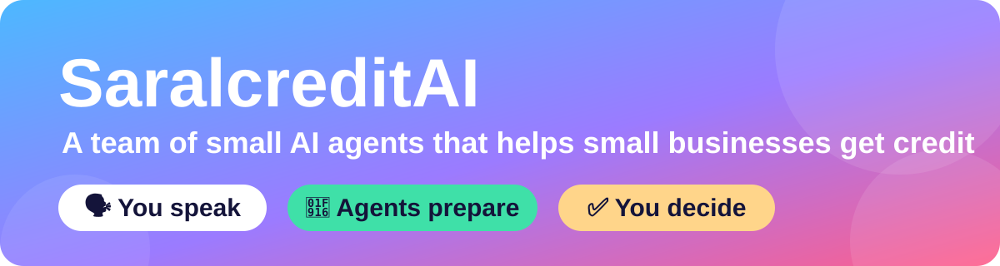
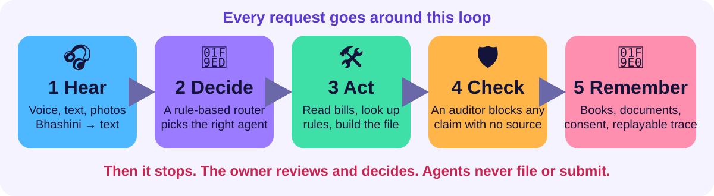
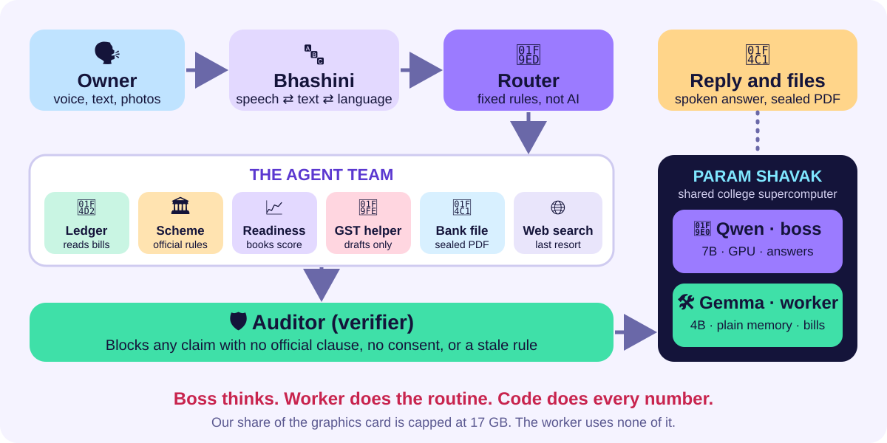
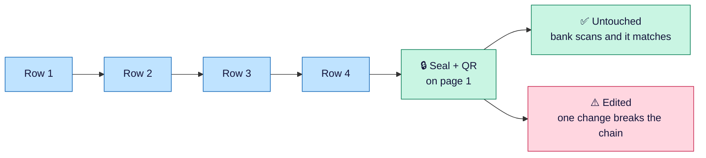
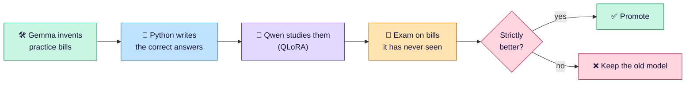
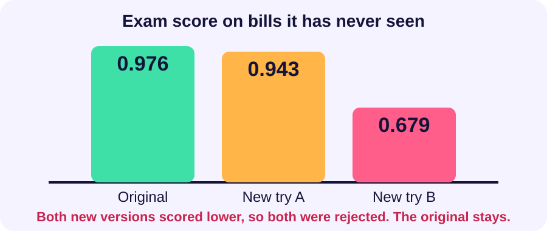

<div align="center">



<br>


**Speak in your language. A team of small AI agents reads your bills, checks the government's rules, and prepares the file a bank needs. You stay in control.**

[Watch the demos](#-watch-it) · [How it works](#-how-it-works-in-one-minute) · [Agentic AI](#-the-heart-of-it-agentic-ai) · [Run it](#-run-it-yourself) · [What is next](#-what-comes-next)

</div>

---

## 💡 The problem in one paragraph

Millions of small business owners in India (tailors, kirana shops, street vendors) qualify for government loans and schemes, and **never apply**. The forms are in English, the rules are scattered across many websites, and nobody tells them what a bank actually wants. A normal chatbot cannot fix this: getting a loan is a *job with many steps*, not a single question.

## ✨ Our idea

> **Build a team of small AI agents, not one chatbot.**
> Each agent has one job. A strict auditor checks the work. The owner makes every decision.

| | What the owner gets |
|---|---|
| 🗣️ | **Talk in their own language.** Voice or text, in Kannada, Hindi or English. |
| 📒 | **Bills become books.** Send a photo or PDF and it lands in the ledger. |
| 🏛️ | **Scheme answers with proof.** It names the scheme and the exact official rule it used. |
| 📈 | **A readiness score.** How ready are my books and GST habits for a loan, and what should I fix? |
| 🎯 | **"What would make me eligible?"** Every condition shown as met, not met or unknown, with the reason. |
| 📁 | **A bank-ready file.** A PDF with income, proofs and eligibility, sealed so the bank can verify it. |

---

## 🎬 Watch it

| 🎥 Demo | 🔐 Trust demo | 🧑‍🏫 Technical explainer |
|---|---|---|
| The whole product, Kannada voice and English | Sealed files, scheme fit and readiness in English, Hindi and Kannada | The tech explained for non-technical viewers |
| [**Watch on Drive**](https://drive.google.com/file/d/1V9TAmQRKxwu_3EQzT1bpwPWRZcsEfmC3/view?usp=sharing) | [**Watch on Drive**](https://drive.google.com/file/d/1u7RdKy2xO-AGNXNwJ_Az3tqlhTSrF3W-/view?usp=sharing) | [**Watch on Drive**](https://drive.google.com/file/d/1LUxE3L1YWcIwVMbuvdNytOd7SEp9xHd6/view?usp=sharing) |

---

## 🧭 How it works in one minute

```mermaid
flowchart LR
    A["🗣️ Owner asks<br/>by voice"]:::blue --> B["🔤 Bhashini<br/>speech to text"]:::violet
    B --> C["🧭 Router<br/>picks the agent"]:::violet
    C --> D["🏛️ Scheme agent<br/>finds official clauses"]:::green
    D --> E["🧠 Boss model<br/>writes the answer"]:::amber
    E --> F["🛡️ Auditor<br/>blocks uncited claims"]:::rose
    F --> G["🔊 Reply spoken<br/>in the owner's language"]:::blue
    classDef blue fill:#BFE3FF,stroke:#1368B8,color:#14143A
    classDef violet fill:#E3D9FF,stroke:#5B38D0,color:#14143A
    classDef green fill:#C9F5E3,stroke:#0B7F58,color:#14143A
    classDef amber fill:#FFE3B0,stroke:#A65F00,color:#14143A
    classDef rose fill:#FFD6E0,stroke:#C8244E,color:#14143A
```



Four of those six steps are plain code. The AI model is used **only where language is needed**.

---

## 🤖 The heart of it: agentic AI

A **chatbot** takes a question and writes an answer.
An **agent** takes a goal and works through it in steps.



### Meet the team

| Agent | Think of it as | What it does |
|---|---|---|
| 🧭 **Router** | The receptionist | Reads each message and sends it to the right agent, using fixed rules |
| 📒 **Ledger** | The bookkeeper | Reads bills and adds them to the books. The arithmetic is done in code |
| 🏛️ **Scheme** | The scheme officer | Looks up official clauses across 11 government schemes and cites the ones it used |
| 📈 **Readiness** | The books checker | Scores how ready your books and GST habits are, with consent |
| 🎯 **Fit** | The eligibility advisor | Shows each condition as met, not met or unknown, with the clause behind it |
| 🧾 **GST helper** | The tax assistant | Drafts GST summaries. Drafts only, clearly labelled |
| 📁 **Dossier** | The file preparer | Builds the bank file and loan application as a sealed PDF |
| 🛡️ **Verifier** | The auditor | Blocks any claim with no official clause, no consent or a stale rule |

### Agents that stay in their lane

> 🟢 **Agents prepare. The owner decides.** No agent can file a GST return or submit a loan.

- **Each agent has its own short list of tools.** It cannot use anyone else's.
- **The router is rule-based on purpose.** Letting the model pick freely was less reliable in our tests.
- **Money and rules are code, not guesses.** The AI never calculates a number.
- **Every step is saved.** A replayable trace shows who did what, and which model was used.

### Why plain Python and not LangChain or LangGraph?

Our flows are short and fixed, so a framework would add dependencies and hide the steps between the owner and the citation. We would adopt **LangGraph** for the planned follow-up agent that waits days for a bank. Add a framework when a feature needs it, not for the label.

---

## 🧠 Two models, one supercomputer



| | 🧠 Qwen · the boss | 🛠️ Gemma · the worker |
|---|---|---|
| Size | 7 billion parameters | 4 billion parameters |
| Runs on | Graphics card (GPU) | Ordinary computer memory (CPU) |
| Does | Writes answers, explains rules | Reads bills, does routine jobs |
| Model | Qwen2.5-7B-Instruct (4-bit) on vLLM | Gemma 3 4B (4-bit) on llama.cpp |

Both are **free, open models**. They live on **Param Shavak**, a shared college supercomputer, because a laptop is too small. Our app reaches it over a private network, and we cap ourselves at **17 GB** of its 32 GB graphics memory.

---

## 📚 Honest answers: the open-book exam

AI models can make things up. So before answering, the system **looks up the official rules**, like an open-book exam. This idea is called *retrieval-augmented generation* (RAG).

1. 📚 **Look up** the best clauses from **492 official clauses** across **11 government schemes**, copied word for word with their source link and date.
2. 📖 **Show only those** clauses to the model.
3. ✍️ **Answer and cite.** The model names the clause numbers it used.
4. 🛡️ **Audit.** The verifier drops any citation the model was never shown.

```text
Q  Am I eligible for PMEGP?
(Sources: faq.eligibility_conditions_of_beneficiar.2)
```

**Schemes covered:** MUDRA · PMEGP · CGTMSE · PM SVANidhi · Stand-Up India · PM Vishwakarma · NSIC · SIDBI · Startup India · SISFS.
If a rule changes, we re-fetch the page. No retraining is needed.

---

## 🔐 A bank file that proves itself



- Every ledger row and every proof document goes into a **SHA-256 hash chain**.
- A **QR code** on page 1 opens a public verify page that recomputes the chain, shows the totals, flags later changes to the live books, and checks an uploaded PDF byte for byte.
- *Honest limit:* our server is the only notary. A real deployment would add an outside timestamp authority.

---

## 🧑‍🏫 One AI teaching another

The idea we like most: **the system practises on homework made by another AI, and refuses to change unless it gets better.**





The safety check worked: both new versions scored lower than the original, so we kept it. Next we need a harder exam, because the current one is nearly solved.

---

## ✅ What is real and what is simulated

| Status | What |
|---|---|
| ✅ **Working** | Voice and text assistant · bill reading · scheme answers with citations · document Q&A · readiness score · scheme fit · sealed bank file · loan application draft · PDF and image export |
| 🧪 **Simulated, labelled** | GST filing and loan submission. Nothing is ever really filed |
| ⏸️ **Paused** | WhatsApp, because Meta locked the test account. The same pipeline runs in the browser console |
| 🗂️ **Synthetic data** | All demo businesses are fake and flagged in the database |

**Our promises:** financial data is used only with consent, every eligibility claim cites an official source, and filing stays with the owner.

---

## 🚀 Run it yourself

Needs Python 3.11+ and a PostgreSQL 16 database with the `vector` extension.

```bash
git clone https://github.com/sai20065/MunimAI
cd MunimAI
pip install -r requirements.txt
cp .env.example .env            # add your own Bhashini and database details
psql "$PG_CONNINFO" -f munimai/schema.sql
cd munimai && uvicorn backend.gateway:app --port 8088
```

Open **http://127.0.0.1:8088** for the browser console. It also needs a reachable Qwen endpoint (see `.env.example`).
Run the tests with `python -m pytest munimai/eval`.

> 🔑 `.env` holds live keys and is gitignored. Never commit it.

---

## 🔭 What comes next

| | Plan | Why |
|---|---|---|
| 🔎 | **Search by meaning** | "Loan without guarantee" should find the "collateral-free" rule, in any language. Shipped only if it measurably beats keyword search |
| ⏳ | **Follow-up agent** | Waits days for a bank, watches for rule changes and reminds the owner (LangGraph fits here) |
| 🧪 | **Harder training exam** | Train for scheme questions too, with the same "only if strictly better" rule |
| 💬 | **WhatsApp live** | So owners need no new app |
| 🏛️ | **More schemes** | PMEGP rate tables, CLCSS, Jan Samarth, NIDHI and state programmes |
| ⏱️ | **Outside time stamp** | Make the sealed bank file independently verifiable |
| 🏪 | **Pilot** | 100 real businesses, then a fairness audit and more states |

---

## 🗺️ Where things live

| Folder | What is inside |
|---|---|
| `munimai/backend/agents/` | The agents: ledger, scheme, readiness, fit, compliance, dossier, verifier |
| `munimai/backend/router.py` | The rule-based router |
| `munimai/backend/proof.py` | Sealing and verifying bank files |
| `munimai/backend/kb/` | The official-clause knowledge base |
| `munimai/selfloop/` | The "one model teaches another" training loop |
| `munimai/sim_ui/` | The browser console |
| `munimai/eval/` | The 56 tests |
| `video/` | Scripts that generate the demo videos |

---

<div align="center">

**Built for Tech4Bharat 2026 · Agents prepare, owners decide.**

Licence: not yet chosen.

</div>
