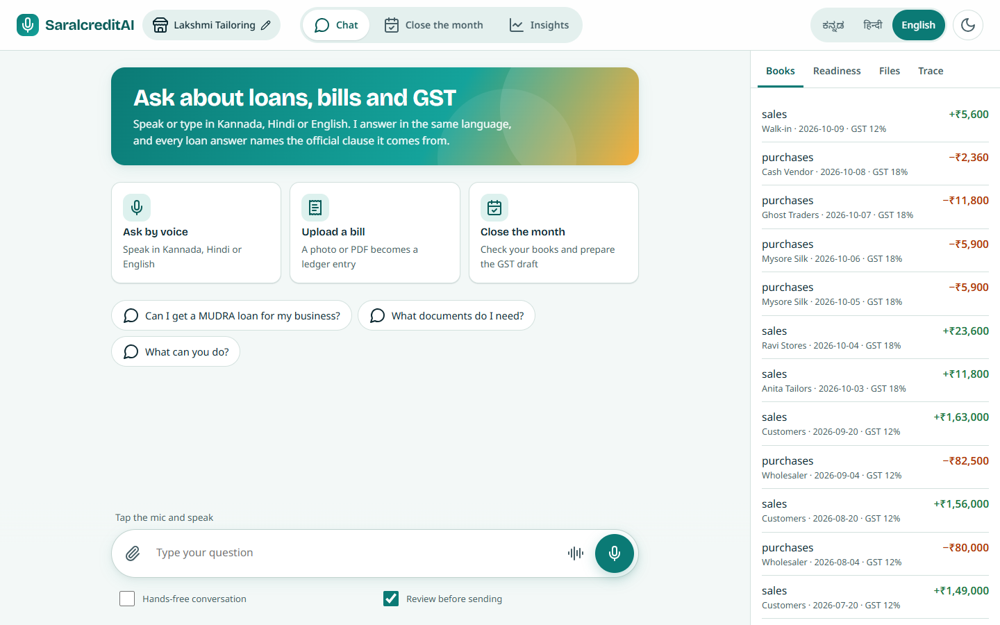
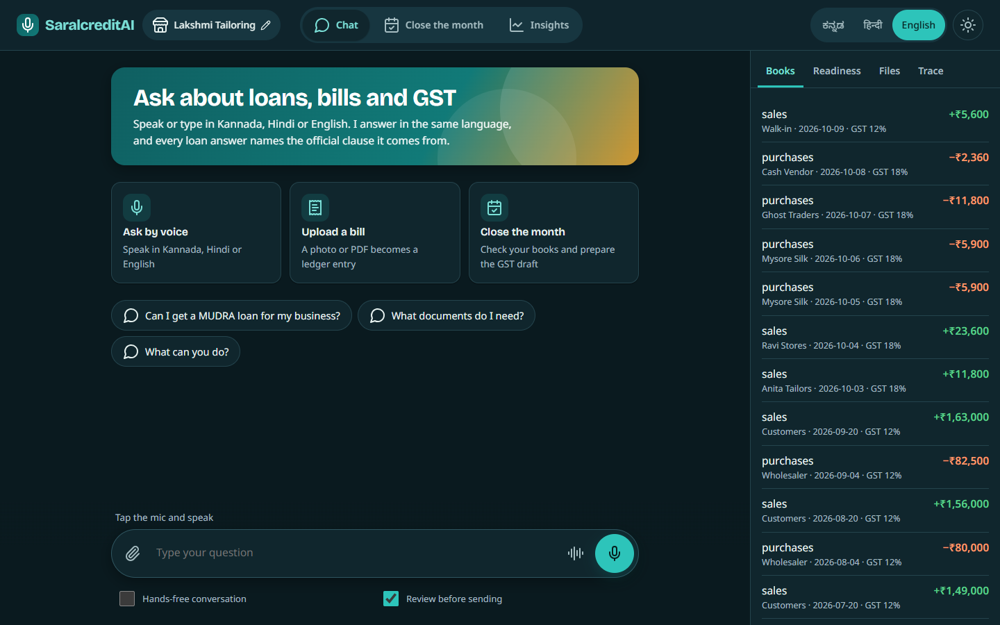
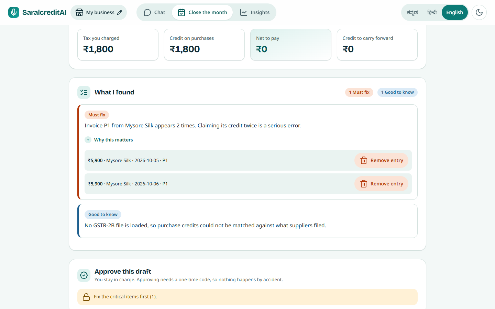
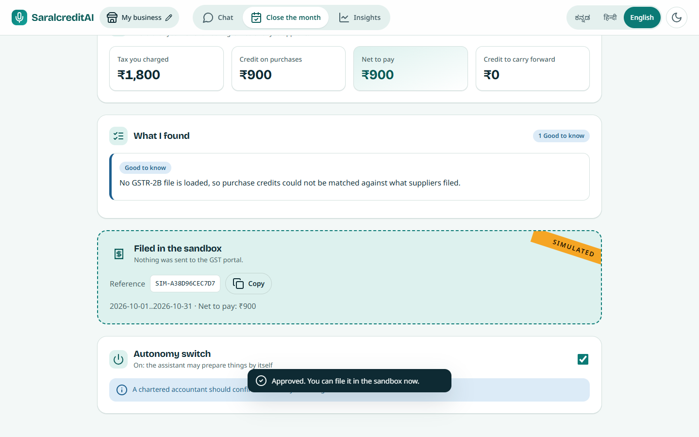
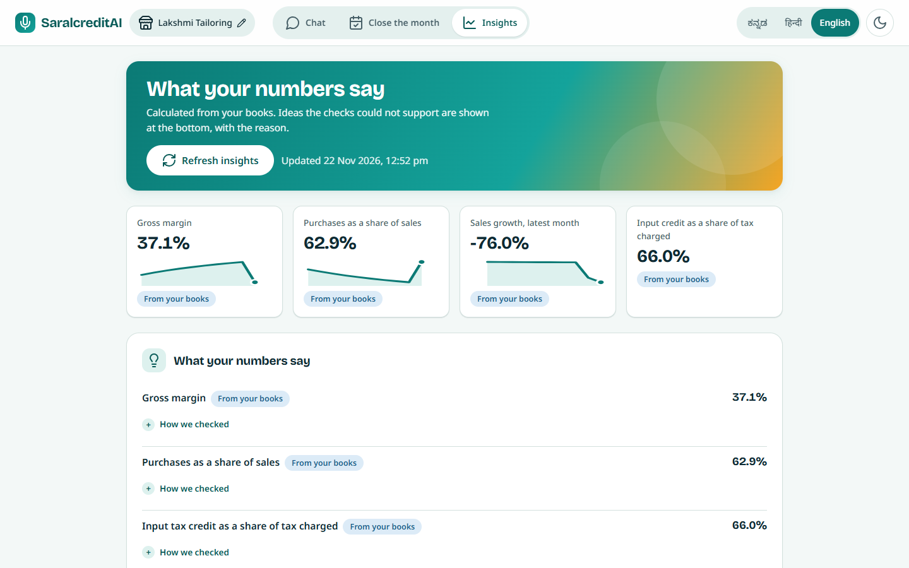
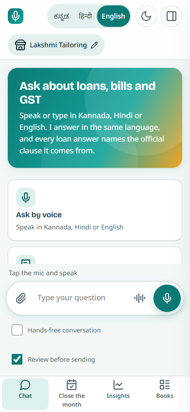
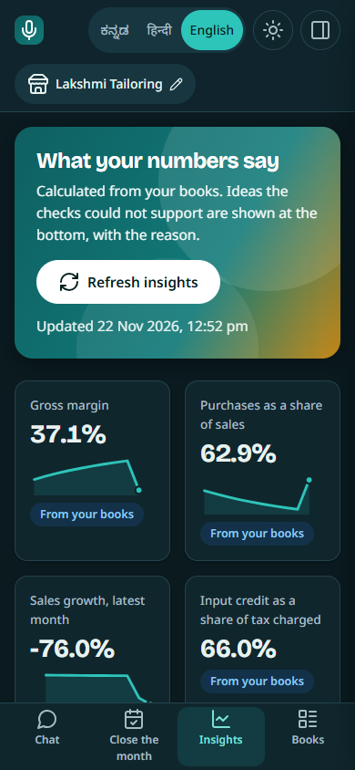

# UX audit of the browser app

I ran this audit myself, as a user would: scripted tasks in Edge at three screen sizes, in light and dark themes, plus an automated
accessibility check. Scripts: `uitest/audit.py` (screens) and `uitest/tasks.py` (tasks). Tests: `eval/test_ui_smoke.py`.

## How it was measured

| Check | Method | Target |
|---|---|---|
| Console errors | Page error and console listeners on every screen | 0 |
| Sideways scrolling | `scrollWidth - innerWidth` at 1440, 820 and 390 px wide | 0 px |
| Touch targets | Every visible button, link, field and tab measured | at least 44 x 44 px |
| Accessibility | axe-core (dev tool, not shipped), serious and critical issues | 0 |
| Tasks | Real clicks, file chooser, fake microphone | all finish, no dead ends |
| Visual review | I looked at every screenshot against a rubric: hierarchy, spacing, clarity, feedback, recovery, empty states | no confusion |

## First pass: what I found, and what I changed

| # | Problem found as a user | Fix |
|---|---|---|
| 1 | On a phone the chat screen scrolled sideways and the mic button was cut off | Grid column and text box could not shrink. Added `minmax(0,1fr)` and `min-width:0` |
| 2 | 36 targets were smaller than 44 px (top tabs, language buttons, month field, checkboxes, "how we checked" rows) | Raised all to 44 px; checkbox rows are now tappable lines |
| 3 | The scrollable areas could not be reached by keyboard | Added focusable, labelled regions |
| 4 | Close the month: after checking, the results sat below a large upload box, so the answer was off screen | Once books are checked the upload box collapses to one line with "Add files" and "Check again" |
| 5 | Insights tiles squeezed the title into 4 lines because the status chip sat beside it | Chip moved to the bottom of the tile |
| 6 | Findings said "Invoice p1" (lowercased by the checker) | Original invoice number is kept |
| 7 | "Why this matters" looked like plain text | Now a visible "+" expander |
| 8 | After approving, the next action ("File in the sandbox") was below the fold | Page scrolls to it and focuses it |
| 9 | Phone: the hands-free sentence took three lines and the empty send button wasted width, so the placeholder was cut | Short label with the long sentence as a tooltip; the send button appears only when there is text |
| 10 | A 404 in the console | Added a favicon |

## Final result

| Check | Result |
|---|---|
| Screens audited | 18 (3 screens x 3 sizes x 2 themes) |
| Console errors, sideways scroll, small targets, serious/critical axe issues | **0** |
| Tasks passed | **6 of 6** |

| Task | Result |
|---|---|
| T1 First visit by keyboard: dialog takes focus, Esc closes it, tabs reach every section | pass, 13 keys |
| T2 Upload a bill and see it in Books | pass, 2 clicks |
| T3 Import, find the duplicate, remove it, approve with the wrong code (refused) then the right one, file in the sandbox | pass, 8 clicks, about 18 s. The approval is blocked while a critical finding is open. |
| T4 Insights: read tiles, open "how we checked" | pass, 2 clicks |
| T5 English dictation with a fake microphone: the words appear in the box (local Whisper) | pass, about 3 s to transcribe |
| T6 Kannada on a phone: labels shown, no sideways scroll | pass |

## Voice

English speech goes to local faster-whisper (MIT). On the laptop CPU a 10 second clip takes about 3 seconds. It heard all three test clips
correctly, including "PMEGP" and "Saralcredit AI". Hindi and Kannada stay on Bhashini.

## Known limits

- Automated checks cannot judge taste or wording. A person should still look at it.
- Hindi and Kannada strings were written by me and need a native speaker to review. Messages that come from the server (the findings text) are in English.
- The five screens were tested with Edge only.
- The "progress" steps while checking the books are a visual guide; the check itself runs in one request.

## Screenshots

